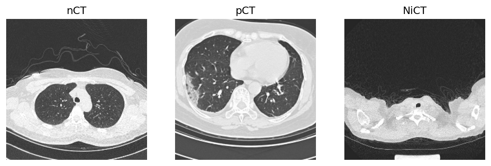
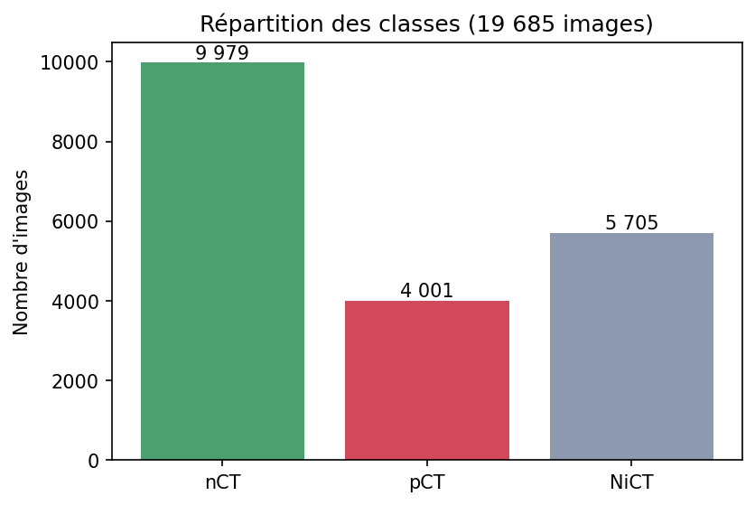
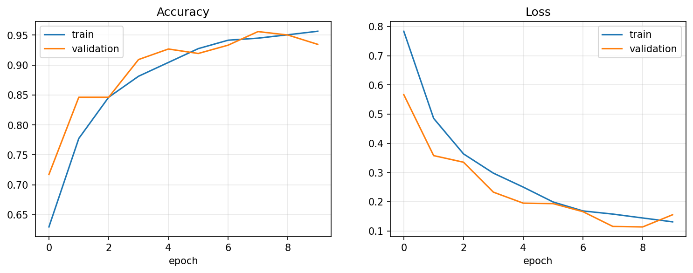
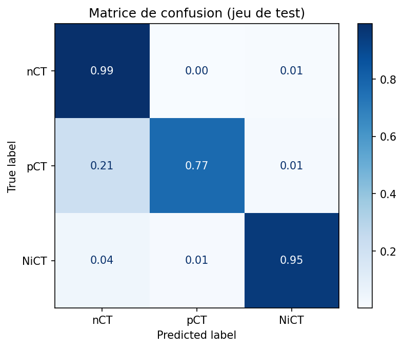

# Classification de scanners thoraciques COVID-19 avec un CNN (TensorFlow)

Un réseau de neurones convolutif (CNN) construit **from scratch** avec TensorFlow/Keras, qui classe une coupe de scanner thoracique (CT) dans l'une de 3 classes : normal, COVID-19 ou non informatif. Il atteint **93,74 % d'accuracy** sur un jeu de test de 2 953 images, avec seulement 110 147 paramètres.

L'entraînement a été réalisé sur le **GPU gratuit de Google Colab**.



> Projet d'apprentissage. Ce n'est pas un dispositif médical et il ne doit jamais servir à prendre des décisions de santé.

## Sommaire:

1. [Objectif](#1-objectif)
2. [Les données](#2-les-données)
3. [Le modèle](#3-le-modèle)
4. [Entraînement](#4-entraînement)
5. [Résultats](#5-résultats)
6. [Lancer le projet](#6-lancer-le-projet)
7. [Structure du dépôt](#7-structure-du-dépôt)
8. [Limites](#8-limites)
9. [Pistes d'amélioration](#9-pistes-damélioration)
10. [Remerciements](#10-remerciements)

## 1. Objectif

Chaque image est une coupe axiale d'un scanner thoracique. Le modèle doit prédire sa classe :

| Classe | Signification | Images |
| ------ | ------------- | ------ |
| `nCT`  | Normal : poumons visibles, sans signe de COVID-19 | 9 979 |
| `pCT`  | Positif : changements typiques d'une pneumonie COVID-19 | 4 001 |
| `NiCT` | Non informatif : la coupe ne montre pas assez les poumons pour juger | 5 705 |

La troisième classe est importante en pratique : un scanner contient beaucoup de coupes au-dessus et en dessous des poumons, et un modèle utile doit savoir les reconnaître au lieu de les forcer en « normal » ou « positif ».



## 2. Les données

- **Source** : [CT Scans for COVID-19 Classification](https://www.kaggle.com/datasets/azaemon/preprocessed-ct-scans-for-covid19) (Kaggle), téléchargé avec `kagglehub`.
- **Version utilisée** : le dossier `Original CT Scans` (le dataset contient aussi une version prétraitée, non utilisée ici).
- **Découpage** (aléatoire, stratifié, `random_state=42`) :

| Jeu | Part | Images | Rôle |
| --- | ---- | ------ | ---- |
| Train | 70 % | 13 779 | Apprentissage |
| Validation | 15 % | 2 953 | Suivi pendant l'entraînement |
| Test | 15 % | 2 953 | Évaluation finale, jamais vu pendant l'entraînement |

Le découpage est **stratifié** (chaque jeu garde les mêmes proportions de classes) et **reproductible** grâce à la graine fixe.

- **Prétraitement** : lecture en RGB, redimensionnement en 224 × 224, pipeline `tf.data` (batch de 32, `prefetch`). La normalisation des pixels (0-255 vers 0-1) est faite dans le modèle par une couche `Rescaling`.

## 3. Le modèle

Un CNN léger de 3 blocs convolutifs, suivi d'une petite tête de classification.

| Couche | Rôle |
| ------ | ---- |
| `RandomFlip("horizontal")` | Augmentation de données (actif seulement à l'entraînement) |
| `Rescaling(1/255)` | Normalise les pixels entre 0 et 1 |
| `Conv2D(32)` + `MaxPooling2D` | Détecte des motifs simples (bords, textures), 224 → 112 |
| `Conv2D(64)` + `MaxPooling2D` | Motifs plus complexes, 112 → 56 |
| `Conv2D(128)` + `MaxPooling2D` | Motifs de haut niveau, 56 → 28 |
| `GlobalAveragePooling2D` | Résume chaque carte de features en une valeur (vecteur de 128) |
| `Dense(128, relu)` + `Dropout(0.3)` | Combine les features, limite le surapprentissage |
| `Dense(3, softmax)` | Une probabilité par classe |

**110 147 paramètres** au total (430 Ko), tous entraînables.

## 4. Entraînement

| Paramètre | Valeur |
| --------- | ------ |
| Framework | TensorFlow / Keras |
| Matériel | **GPU de Google Colab** (environ 84 s par epoch) |
| Optimiseur | Adam (learning rate par défaut) |
| Fonction de perte | `sparse_categorical_crossentropy` |
| Batch size | 32 |
| Epochs | 10 |
| Taille d'entrée | 224 × 224 × 3 |

## 5. Résultats

| Jeu | Images | Accuracy |
| --- | ------ | -------- |
| Train | 13 779 | 95,65 % |
| Validation | 2 953 | 93,46 % |
| **Test** | **2 953** | **93,74 %** |

Loss finale : 0,131 (train) et 0,155 (validation).

Les scores de validation et de test sont très proches, ce qui indique que le modèle généralise correctement. L'écart d'environ 2 points avec le train est un léger surapprentissage, attendu à ce stade. L'accuracy d'entraînement est mesurée avec l'augmentation et le dropout actifs.



### Résultats par classe (jeu de test)

<!-- Remplir avec la sortie de classification_report (cellule graphes) -->

| Classe | Precision | Recall | F1-score |
| ------ | --------- | ------ | -------- |
| `nCT`  | … | … | … |
| `pCT`  | … | … | … |
| `NiCT` | … | … | … |

La matrice de confusion montre quelles classes sont confondues par le modèle (lignes : vraie classe, colonnes : classe prédite, valeurs normalisées par ligne).



## 6. Lancer le projet

Le plus simple est d'utiliser **Google Colab** :

1. Ouvrir le notebook dans Colab.
2. Activer le GPU : *Exécution → Modifier le type d'exécution → GPU*.
3. Exécuter les cellules dans l'ordre : le dataset est téléchargé automatiquement par `kagglehub`.

En local :

```bash
git clone https://github.com/<ton-pseudo>/<ton-repo>.git
cd <ton-repo>

python -m venv .venv
source .venv/bin/activate        # Windows : .venv\Scripts\activate
pip install tensorflow kagglehub scikit-learn matplotlib numpy
```

Un GPU est fortement recommandé : sur CPU, l'entraînement est beaucoup plus lent.

## 7. Structure du dépôt

```
.
├── notebook.ipynb        Notebook : données, modèle, entraînement, évaluation
├── cnn_scratch.keras     Modèle entraîné
├── assets/               Graphes utilisés dans ce README
└── README.md
```

Charger le modèle sans réentraîner :

```python
import tensorflow as tf
model = tf.keras.models.load_model("cnn_scratch.keras")
```

## 8. Limites

- **Le découpage est fait par image, pas par patient.** Le dataset contient plusieurs coupes très proches pour un même patient, qui peuvent se retrouver à la fois dans le train et dans le test. Le score de test est donc probablement plus optimiste que sur de nouveaux patients.
- **Sources de données limitées.** Les scanners viennent de deux hôpitaux de Wuhan. Le modèle n'a pas été évalué sur d'autres appareils, protocoles ou populations.
- **Coupes isolées.** Le modèle juge une coupe à la fois, alors qu'une évaluation clinique considère le scanner complet, les symptômes et les analyses.
- **Modèle volontairement simple**, entraîné 10 epochs seulement.

## 9. Pistes d'amélioration

- Comparer avec du **transfer learning** (MobileNetV3-Large pré-entraîné sur ImageNet, fine-tuning).
- Découper les données **par patient** pour une évaluation plus réaliste.
- Ajouter plus d'augmentations (rotation, zoom, contraste) et entraîner plus longtemps.
- Visualiser ce que regarde le modèle (Grad-CAM).

## 10. Remerciements

- **Dataset** : *CT Scans for COVID-19 Classification* par Abu Zahid Bin Aziz, licence CC BY 4.0. Images issues de la ressource [iCTCF](http://ictcf.biocuckoo.cn/) : Ning, W. et al., « iCTCF: an integrative resource of chest computed tomography images and clinical features of patients with COVID-19 pneumonia » (2020).


